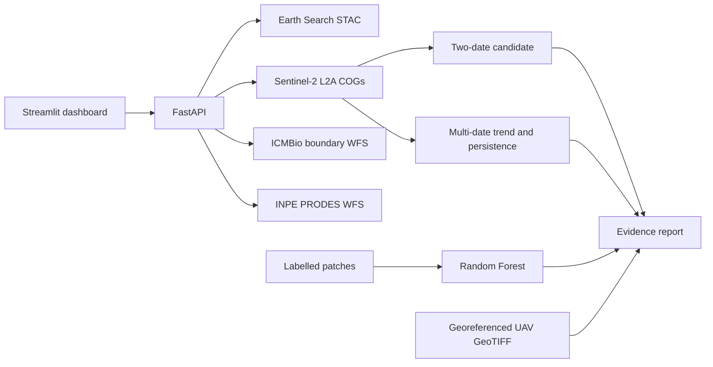

# ForestProof v5

ForestProof is an evidence-review system for protected-forest monitoring in Floresta Nacional do Jamanxim, Pará, Brazil. It combines Sentinel-2 scene processing, a multi-date vegetation trend, explainable NDVI candidates, optional Random Forest classification, georeferenced UAV verification, source links, and evidence reports.

ForestProof reports candidates for human review. It does not prove illegal activity, mining, road construction, or deforestation by itself.

## Project structure

```text
ForestProof_v5/
├── .env.example            Local backend URL example (no credentials)
├── .gitignore              Ignores secrets and generated evidence/model files
├── .streamlit/config.toml   Streamlit presentation settings
├── render.yaml             Render FastAPI service configuration
├── main.py                 FastAPI backend and geospatial processing
├── app.py                  Streamlit dashboard
├── ml_service.py           Random Forest training and prediction
├── requirements.txt        Runtime dependencies
├── requirements-dev.txt    Test dependencies
├── DEPLOYMENT.md            GitHub, Render, and Streamlit deployment steps
├── DEMO_SCRIPT.md           Four-minute hackathon demo plan
├── RESPONSIBLE_AI.md        Evidence limits and responsible-use notes
├── tests/test_core.py      Deterministic unit tests
├── forestproof_outputs/    Local history, previews, and trained model state
└── README.md
```

The Streamlit frontend reads the backend base URL from the `FORESTPROOF_API_URL` Streamlit secret or environment variable. It defaults to `http://127.0.0.1:8000` for local development. See [DEPLOYMENT.md](DEPLOYMENT.md) for hosting steps and [DEMO_SCRIPT.md](DEMO_SCRIPT.md) for the four-minute walkthrough.

## Architecture



## What v3 adds

- **Multi-date trend analysis:** `POST /analyze-timeseries` searches several same-tile acquisitions, screens clouds/shadows, prefers comparable seasonal months, calculates mean NDVI observations, and counts persistent decreases.
- **Seasonal-risk indicator:** the result reports whether the selected observations cover a narrow or broad range of months. This is a risk indicator, not a complete rainfall or phenology model.
- **Severity and inspection priority:** results include `severity`, `inspection_priority`, and a score from 0–100 based on persistence, quality, and available evidence. The score is a triage aid, not a probability of illegality.
- **Grouped ML validation:** if labelled rows include at least four distinct `group` values such as site IDs or acquisition groups, the model uses a group holdout rather than mixing related pixels across train and test. Otherwise it reports a stratified random holdout.
- **Evidence report:** `GET /evidence-report/{job_id}` returns a portable JSON evidence package for saved analyses.
- **Georeferenced UAV verification:** `/upload-drone-orthomosaic` validates CRS, footprint, resolution, RGB bands, and optional alert overlap. Ordinary JPG/PNG images are rejected as location-unverified evidence.
- **Tests and complete packaging:** runtime and development requirements, deterministic tests, and documentation are included.

## Detection methods

For the two-date satellite path, NDVI is calculated as:

```text
NDVI = (NIR - Red) / (NIR + Red)
```

The current explainable candidate rule is:

```text
baseline NDVI >= 0.50
comparison NDVI < 0.50
NDVI decrease >= 0.20
```

Sentinel-2 SCL classes for no-data, saturation, cloud shadow, clouds, cirrus, and snow are screened. At least 50% usable paired coverage is required before the two-date candidate area is reported.

The multi-date endpoint is intentionally more conservative. It summarizes mean NDVI over the selected protected-area box and identifies persistence across observations. It does not claim to produce a pixel-level multi-date segmentation polygon yet.

## Install and run

Python 3.10 or newer and internet access are required. From the project directory:

### Windows PowerShell

```powershell
py -3.12 -m venv .venv
.\.venv\Scripts\Activate.ps1
python -m pip install --upgrade pip
pip install -r requirements.txt
pip install -r requirements-dev.txt
```

### Linux/macOS

```bash
python3 -m venv .venv
source .venv/bin/activate
python -m pip install --upgrade pip
pip install -r requirements.txt
pip install -r requirements-dev.txt
```

Run the backend and dashboard in separate terminals:

```bash
python -m uvicorn main:app --reload
python -m streamlit run app.py
```

Open `http://localhost:8501`. FastAPI documentation is at `http://127.0.0.1:8000/docs`.

## Tests

```bash
python -m pytest -q
```

The tests cover scene-pair selection, bounding-box checks, ML input validation, predictions, probability output, and grouped validation. They do not contact public satellite services and do not establish scientific or field accuracy.

## API workflow

1. `GET /health` checks that the backend is running.
2. `GET /area/jamanxim` returns the official boundary and suggested box.
3. `POST /analyze-sentinel` runs the existing explainable two-date candidate workflow.
4. `POST /analyze-timeseries` runs multi-date trend and persistence analysis. It accepts `bbox`, `start_date`, `end_date`, `cloud_limit`, `minimum_observations`, and `seasonal_months_only`.
5. `POST /upload-drone-orthomosaic` accepts a georeferenced RGB GeoTIFF and can check overlap with `alert_bbox`.
6. `GET /ml/status` returns the ML feature schema and previous validation record.
7. `POST /train-ml` accepts a JSON list of labelled feature rows. Add a `group` field containing a site, patch, or acquisition identifier for grouped validation.
8. `POST /predict-ml` returns a label, class probabilities, and the validation record.
9. `GET /evidence-report/{job_id}` returns the saved JSON evidence report.

The ML feature columns are:

```text
ndvi_before, ndvi_after, ndvi_drop,
red_before, nir_before, red_after, nir_after,
valid_coverage_percent, candidate_area_hectares
```

A training row must also contain `label`. Example values illustrate the schema only and are not field labels:

```json
{
  "group": "site_001",
  "label": "stable_forest",
  "ndvi_before": 0.82,
  "ndvi_after": 0.80,
  "ndvi_drop": 0.02,
  "red_before": 0.08,
  "nir_before": 0.42,
  "red_after": 0.09,
  "nir_after": 0.40,
  "valid_coverage_percent": 96.0,
  "candidate_area_hectares": 0.0
}
```

## Evaluation discipline

Report precision, recall, macro-F1, confusion matrix, class balance, number of groups, and validation method. Independent sites or acquisition dates should be held out from training. Random pixel splits can overstate generalization because neighbouring pixels and repeated scenes are related.

Do not claim that a software test or synthetic sample is field accuracy. Do not claim Jamanxim-wide accuracy unless the labelled data and holdout design support that statement.

## Evidence language

Prefer `candidate vegetation decrease`, `persistent change review`, `possible exposed-ground disturbance`, and `review recommended`. Do not display `illegal mining detected`. PRODES is independent historical context, not ForestProof's classification. NICFI or CBERS would be satellite evidence, not UAV evidence. Only call an upload UAV/drone evidence when it contains a CRS and geographic footprint.

## Remaining limitations

- Sentinel-2 is not a live feed.
- The multi-date trend currently summarizes mean NDVI and does not create a persistent pixel-level change polygon.
- Thresholds have not been locally calibrated with a real Jamanxim validation set.
- Fire, flooding, and natural seasonal change are reported as limitations and risk indicators, not reliably classified causes. Robust masks need external layers or labelled examples.
- The Random Forest contributes predictions only after a real labelled dataset is trained. Its output is a review aid, not a legal or scientific conclusion.
- UAV validation checks metadata and footprint; it does not yet semantically classify drone imagery.
- Legal conclusions require permits, land-tenure information, field evidence, and appropriate authority review.

## Recommended remaining work

Create a documented labelled dataset with stable forest, vegetation loss, bare soil, water/flooding, burned area, road, and unknown examples. Keep sites or dates independent between training and testing. Then add pixel-level temporal persistence, local threshold calibration, external fire/flood masks, and a semantic UAV classifier. Capture screenshots and record one reproducible live run for the final judge demonstration.


## Label Review workflow

The dashboard includes a persistent **Label Review** tab. Run a real Sentinel-2 analysis first, then use **Import latest real Sentinel-2 result for review**. The backend stores it as `uncertain` with its real scene dates, evidence preview, coordinates when available, and extracted satellite features.

Review the evidence and save the sample with one of:

```text
accepted     included in ML training
uncertain    retained for audit but excluded from training
rejected     retained for audit but excluded from training
```

Every sample should have a meaningful `group` such as a site or image patch. Keep all patches from one site in the same group so grouped validation cannot leak neighbouring samples across train and test. Accepted labels require the complete ML feature vector. The API endpoints are:

```text
GET  /labels
POST /labels
POST /labels/from-analysis/{job_id}
GET  /labels/export
POST /train-ml-from-labels
```

The label source is recorded. Use sources such as `INPE PRODES historical reference plus satellite review`, `stable forest multi-date review`, or `water boundary plus satellite review`. PRODES is a useful public historical reference, but it is not perfect field truth. Inspect before/after imagery and keep uncertain samples out of training.

## v4 calculation fixes

- Inspection priority now uses a bounded score from the latest valid NDVI drop, persistence fraction, usable coverage, and seasonal risk. It no longer uses an area value that was always zero in the time-series summary.
- Seasonal comparison uses circular month distance, so December and January are treated as adjacent months.
- The latest observation is selected from the latest **valid** screened acquisition. An invalid trailing observation can no longer overwrite the latest usable result.
- Dedicated regression tests cover all three fixes.

## What still requires genuine data

The software now makes it easy to collect and review genuine Sentinel-2 samples, but it cannot decide labels automatically. A human must inspect each imported sample and either accept, reject, or mark it uncertain. Use real public references where possible, such as PRODES polygons for historical change and visible stable forest or water areas, and record the evidence in `label_source` and `notes`.

Do not report ML accuracy until accepted labels have been reviewed and the test groups or dates were kept independent. The included tests verify software behavior only; they are not field validation.


## Final review workflow

The application remains usable with zero manually accepted labels. The workflow is:

```text
Satellite Analysis → Multi-date Change Detection → Human Review → Evidence Storage → Optional ML Training → Prediction and Reporting
```

The Label Review tab now automatically imports the latest real Sentinel-2 analysis metadata: sample ID, group, coordinates, before/after dates, NDVI values, NDVI difference, severity, candidate area, and saved visual evidence when available. Selecting an existing sample loads it for editing. Saving the same `sample_id` replaces the record rather than creating a duplicate. Notes are optional.

The review dashboard shows total, pending/uncertain, accepted, rejected, and accepted counts by label. Samples can be filtered by label and review status. If an evidence preview is missing, the UI displays an explanation instead of a broken image.

ML readiness is shown separately from review. Training remains optional and is disabled until at least 10 accepted samples across at least 2 classes exist. No accuracy, precision, recall, F1, or confusion matrix is displayed as a claim before genuine validation has been performed.

## Final run steps

From the extracted `ForestProof_v5` directory:

```bash
python3 -m venv .venv
source .venv/bin/activate  # Windows: .venv\Scripts\Activate.ps1
pip install -r requirements.txt
pip install -r requirements-dev.txt
python -m pytest -q
```

Start the services in separate terminals:

```bash
python -m uvicorn main:app --reload
python -m streamlit run app.py
```

Open `http://localhost:8501`. For the hackathon demo, run a satellite analysis, open Label Review, import the latest result, review the evidence, and show the stored evidence/report. You do not need to train ML before submission.
